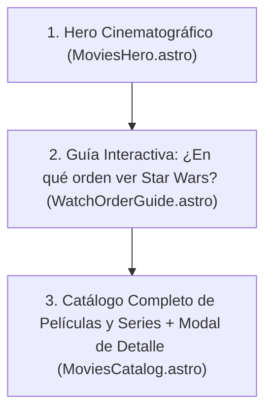

# Plan: Módulo de Películas & Series (`/movies` + `/api/movies`)

Este documento define el diseño visual, la experiencia de usuario y la arquitectura limpia (`src/core/movies` + `src/modules/movies`) para transformar `src/pages/movies.astro` en un archivo interactivo completo de **Películas y Series de Star Wars**, incluyendo una **Guía Interactiva de Orden de Visionado**.

---

## 1. Estructura Visual de `/movies` (3 Secciones Clave)



### Sección 1: Diseño del Hero (`MoviesHero.astro`)

| Opción | Concepto Visual | Qué incluye |
| :--- | :--- | :--- |
| **Opción A (Recomendada): "Archivo Cronológico Galáctico (ABY / DBY)"** | Estética de terminal imperial/Jedi con una **línea de tiempo luminosa horizontal** de las 6 Eras oficiales (*Alta República → Caída de los Jedi → Imperio → Rebelión → Nueva República → Primera Orden*). | • Badge `SECTOR AUDIOVISUAL // CRONOLOGÍA OFICIAL`<br>• Título imponente + contadores rápidos (`11 Películas`, `12+ Series Live-Action & Animadas`, `6 Eras Galácticas`)<br>• 2 botones principales: **"Ver Orden Recomendado ↓"** (baja suave a la guía) y **"Explorar Catálogo ↓"** |
| **Opción B: "Selector de Camino (¿Primera vez o Maratón?)"** | El Hero actúa como un asistente interactivo directo para el visitante. | • Dos tarjetas destacadas dentro del Hero:<br>  1. *"Soy nuevo en la Galaxia"* (Activa automáticamente el Orden de Estreno / Machete).<br>  2. *"Quiero la historia cronológica"* (Activa el Orden Cronológico por año galáctico ABY/DBY). |
| **Opción C: "Cartelera Destacada + Radar de Próximos Estrenos"** | Hero dividido en 2 columnas: a la izquierda la presentación del archivo audiovisual y a la derecha un panel táctico con el **Próximo Estreno en Cines/Disney+** (ej. *The Mandalorian & Grogu*). | • Ideal para integrar actualidad de lanzamientos futuros sin tener que mantener un blog manual de noticias. |

> **Recomendación de diseño**: Combinar la **Opción A** (con las Eras Galácticas interactivas) + un indicador táctico discreto de la **Opción C** (*"Próxima transmisión en cines: The Mandalorian & Grogu"*).

---

### Sección 2: Guía Interactiva "¿En qué orden ver Películas y Series?" (`WatchOrderGuide.astro`)

Justo debajo del Hero, el usuario tendrá un **Conmutador de Ruta de Visionado** con 3 modos explicados claramente:

1. **Orden Cronológico Galáctico (Historia de principio a fin — ABY / DBY)**
   - Ordenado según el calendario interno de Star Wars (tomando la Batalla de Yavin del *Episodio IV: Una Nueva Esperanza* como punto `0 ABY/DBY`).
   - Muestra cómo se intercalan las películas y las series:
     1. *The Acolyte* (`~132 ABY`) — Serie
     2. *Episodio I: La Amenaza Fantasma* (`32 ABY`) — Película
     3. *Episodio II: El Ataque de los Clones* (`22 ABY`) — Película
     4. *Star Wars: The Clone Wars* (`22–19 ABY`) — Serie Animada
     5. *Episodio III: La Venganza de los Sith* (`19 ABY`) — Película
     6. *Star Wars: The Bad Batch* (`19–18 ABY`) — Serie Animada
     7. *Han Solo: Una Historia de Star Wars* (`13–10 ABY`) — Película
     8. *Obi-Wan Kenobi* (`9 ABY`) — Serie
     9. *Andor (Temporadas 1 y 2)* (`5–1 ABY`) — Serie
     10. *Star Wars Rebels* (`5–1 ABY`) — Serie Animada
     11. *Rogue One: Una Historia de Star Wars* (`0 ABY`) — Película
     12. *Episodio IV: Una Nueva Esperanza* (`0 ABY`) — Película
     13. *Episodio V: El Imperio Contraataca* (`3 DBY`) — Película
     14. *Episodio VI: El Retorno del Jedi* (`4 DBY`) — Película
     15. *The Mandalorian (Temporadas 1 y 2)* (`9 DBY`) — Serie
     16. *El Libro de Boba Fett* (`9 DBY`) — Serie
     17. *The Mandalorian (Temporada 3)* (`9–10 DBY`) — Serie
     18. *Ahsoka* (`10 DBY`) — Serie
     19. *Skeleton Crew* (`10 DBY`) — Serie
     20. *Episodio VII: El Despertar de la Fuerza* (`34 DBY`) — Película
     21. *Episodio VIII: Los Últimos Jedi* (`34 DBY`) — Película
     22. *Episodio IX: El Ascenso de Skywalker* (`35 DBY`) — Película

2. **Orden de Estreno (Experiencia Original)**
   - Empieza por la Trilogía Original (`1977–1983`), continúa con las Precuelas (`1999–2005`), Secuelas (`2015–2019`), Spin-offs y Series.
   - Ideal para quienes ven la saga por primera vez y quieren preservar el giro argumental del *Episodio V*.

3. **Orden "Esencial / Primera Vez" (Ruta Directa)**
   - Filtra únicamente las películas de la Saga Skywalker + *Rogue One* + *Andor* + *The Mandalorian*, para entender el corazón de Star Wars en menos tiempo.

Cada paso de la ruta muestra:
- **Número de paso** (`#01`, `#02`...)
- **Año Galáctico** (`32 ABY`, `0 ABY`, `9 DBY`) y **Año Real de estreno** (`1977`, `2022`).
- **Etiqueta de Formato**: `PELÍCULA` (dorado) vs `SERIE` (cian/azul) + duración o número de temporadas.
- **Conexión rápida**: Al hacer clic en cualquier elemento de la ruta, se abre su ficha técnica detallada en el modal.

---

### Sección 3: Catálogo de Películas y Series (`MoviesGrid.astro` + `MovieModal.astro`)

- **Filtros rápidos (Pills)**:
  - Por formato: `Todos` | `Películas` | `Series Live-Action` | `Series Animadas`
  - Por Era Galáctica: `Alta República` | `Caída de los Jedi` | `Reinado del Imperio` | `Era de la Rebelión` | `Nueva República` | `Ascenso de la Primera Orden`
  - Buscador en tiempo real por título, director o personaje.
- **Tarjeta (`MovieCard.astro`)**:
  - Póster/arte con fallback holográfico del Holocrón, título en español + título original, badge `PELÍCULA` o `SERIE`, año de estreno, año galáctico (`ABY/DBY`), era y duración/temporadas.
- **Modal de Detalle (`MovieModal.astro`)**:
  - Sinopsis sin spoilers, director/creador, era galáctica, personajes clave que aparecen, posición en cada orden de visionado, y recomendación de *"Qué ver antes"* y *"Qué ver después"*.

---

## 2. Arquitectura Limpia (`src/core/movies` + `src/modules/movies`)

Siguiendo la arquitectura documentada en `ARCHITECTURE.md`:

```text
src/
├── core/
│   └── movies/
│       ├── domain/
│       │   ├── MediaItem.ts              # Entidad rica POO (isMovie, isSeries, matchesCriteria, etc.)
│       │   └── IMediaRepository.ts       # Contrato e interfaces de filtrado y ordenamiento
│       ├── application/
│       │   ├── dtos/
│       │   │   └── MediaItemDTO.ts       # DTO serializable y mapper toMediaItemDTO
│       │   └── use-cases/
│       │       ├── GetMediaItems.ts      # Listado, búsqueda, filtro por era/tipo y orden de visionado
│       │       └── GetMediaItemById.ts   # Búsqueda individual por ID o slug
│       ├── infrastructure/
│       │   └── LocalMediaRepository.ts   # Implementación sobre dataset local JSON
│       └── index.ts                      # Composition Root del módulo movies
│
├── modules/
│   └── movies/
│       ├── components/
│       │   ├── MoviesHero.astro          # Hero cinematográfico con Eras Galácticas
│       │   ├── WatchOrderGuide.astro     # Guía interactiva de orden de visionado (3 modos)
│       │   ├── MovieCard.astro           # Tarjeta individual de película/serie
│       │   ├── MoviesGrid.astro          # Grilla filtrable + buscador + pills
│       │   └── MovieModal.astro          # Modal de detalle con navegación Prev/Next
│       ├── data/
│       │   ├── index.ts
│       │   └── movies.json               # Dataset curado de películas y series en español
│       └── types/
│           └── movie.types.ts
│
└── pages/
    ├── movies.astro                      # Página principal de Películas & Series
    └── api/
        └── movies/
            ├── index.ts                  # GET /api/movies (?type=, ?era=, ?order=, ?search=)
            └── [id].ts                   # GET /api/movies/[id]
```

---

## 3. Fases de Implementación

1. **Fase 1 — Dataset y Core (`src/core/movies` + `src/modules/movies/data/movies.json`)**:
   - Crear el archivo JSON con las películas y series, incluyendo orden cronológico, orden de estreno, ruta esencial, era galáctica, año `ABY/DBY`, director, duración/temporadas y sinopsis.
   - Implementar la entidad `MediaItem`, repositorio `LocalMediaRepository` y casos de uso `GetMediaItems` / `GetMediaItemById`.
2. **Fase 2 — Endpoints de la API REST (`/api/movies` y `/api/movies/[id]`)**:
   - Habilitar filtros por `?type=movie|series`, `?era=`, `?order=chronological|release|essential` y `?search=`.
   - Actualizar la documentación en `src/content/docs/peliculas/listar.md`.
3. **Fase 3 — Interfaz Visual en `/movies` y actualización de Home**:
   - Construir `MoviesHero.astro`, `WatchOrderGuide.astro`, `MoviesGrid.astro`, `MovieCard.astro` y `MovieModal.astro`.
   - Actualizar `src/components/home/ArchiveSectors.astro` para marcar el sector **Películas & Series** como activo.
